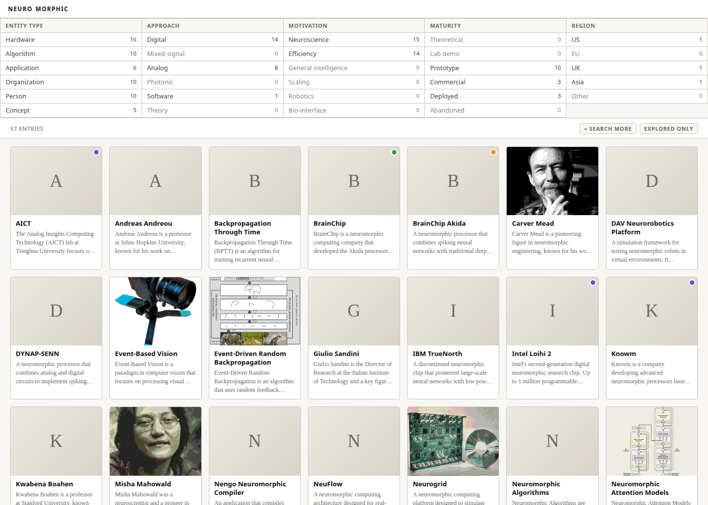
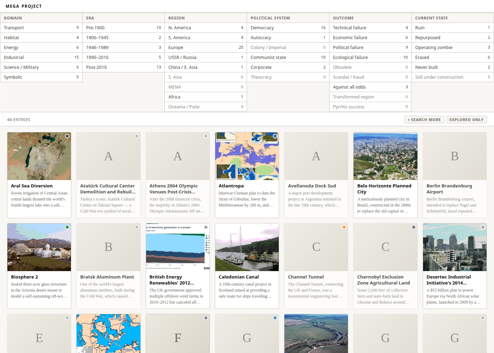
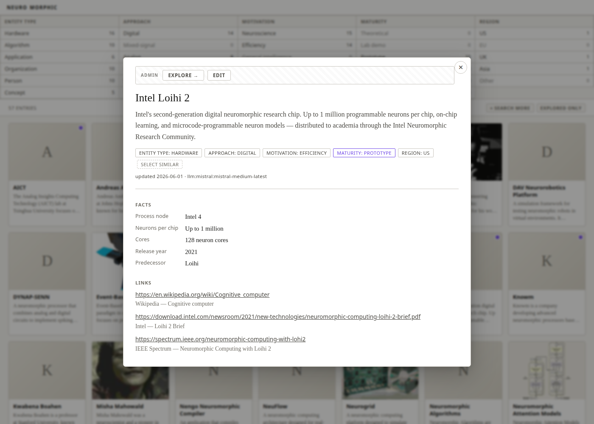
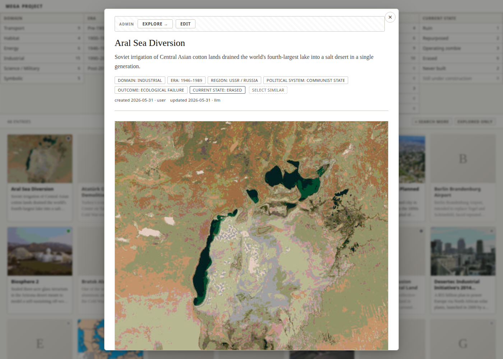

# Raymond

**A computer-assisted attempt at exhausting a subject.**

Pick a subject. Define the axes that cut it. Take the Cartesian product, and let an LLM
propose what lives in each cell — the obvious ones, and the ones nobody would have thought
to write down. Then browse the result by combining filters, not by searching.

1. **Define the axes** — e.g. *entity type × approach × motivation × maturity × region*.
2. **Take the product** — every combination is a question: *what exists here?*
3. **Fill the cells** — an LLM proposes entries, then grounds them in Wikipedia/Wikidata.
4. **Read the map** — empty cells are as informative as full ones.

Named after Raymond Queneau, whose [*Cent mille milliards de poèmes*](https://fr.wikipedia.org/wiki/Cent_mille_milliards_de_po%C3%A8mes)
([en](https://en.wikipedia.org/wiki/A_Hundred_Thousand_Billion_Poems)) is a Cartesian product made
book: ten sonnets cut into strips, 10¹⁴ possible poems. In the spirit of Perec's *Tentative
d'épuisement d'un lieu parisien* too: exhaustion is impossible, and trying is the method.

> **Status: archived (June 2026).** The framework works end to end — generate, enrich, curate, browse, export — and ships two example wikis. The data itself is not versioned (see [Data](#data)).



## Idea

A wiki is not an encyclopedia. It is a *space* of entries, each tagged along a handful of **axes** (e.g. *entity type × approach × motivation × maturity × region*). The axis bar is the primary navigation: pick values, see the intersecting cards. The axes are the wiki's editorial point of view.

Each entry is a card first, a detail modal second: a title, a short summary, axis values, plus — once **explored** — facts, links and an image. There is no long-form prose by default.

An entry has one of two trust levels:

| Status | Meaning |
|---|---|
| `generated` | proposed by an LLM from an axis combination; unverified |
| `explored` | grounded in Wikipedia/Wikidata enrichment, facts and links filled in |

The full design rationale is in [project_vision.md](project_vision.md).

## Example wikis

| Wiki | Entries | Axes |
|---|---|---|
| `neuromorphic` — chips that pretend to be brains | 57 | entity type, approach, motivation, maturity, region |
| `megaprojects` — things humanity bet a civilization on | 48 | domain, era, region, political system, outcome, current state |



Clicking a card opens the detail view (facts, links, image). In dev mode it also exposes **Explore** (LLM + web enrichment) and **Edit** buttons.

| Neuromorphic | Megaprojects |
|---|---|
|  |  |

## How it works

```
  axis.json + wiki.json + prompts/        (tracked — the wiki's definition)
          │
          ▼  generate   LLM proposes entries for an axis combination
  catalogue/<slug>.json                   status: generated
          │
          ▼  fetch      Wikipedia / Wikidata text, facts, lead image
  enrichments/<slug>.json, media/<slug>/
          │
          ▼  explore    LLM fills facts + links, grounded in the enrichment
  catalogue/<slug>.json                   status: explored
          │
          ▼  build_index
  index.jsonl  ──►  frontend/ (vanilla JS)   or   dist/<wiki>/ static bundle
```

- **One file per entry** under `wikis/<wiki>/catalogue/`; git history is the changelog.
- **Frontend**: a single shared page ([frontend/index.html](frontend/index.html)) with no build step. It reads `wiki.json`, `axis.json` and `index.jsonl`.
- **Dev mode** (Flask) adds an edit API; **static mode** is the same files without it.
- **LLM backends** are chosen per prompt in `wiki.json` → `models`, as `"<provider>:<model>"`: `claude:` (shells out to the `claude` CLI) or `mistral:` (API).

## Quick start

Requires Python ≥ 3.11 and [uv](https://docs.astral.sh/uv/).

```bash
uv sync --extra dev
cp .env.example .env            # add MISTRAL_API_KEY if you use mistral: models
```

Create a wiki's data folders (they are git-ignored, so they don't exist on a fresh clone), then serve it:

```bash
mkdir -p wikis/neuromorphic/{catalogue,enrichments,media}
uv run python tools/atlas.py serve --wiki neuromorphic       # http://127.0.0.1:8765
```

With an empty catalogue you get the axis bar and no cards. Fill it from the CLI:

```bash
# propose 5 entries for an axis combination
uv run python tools/atlas.py generate --wiki neuromorphic --n 5 --axis entity_type=hardware

# fetch Wikipedia/Wikidata enrichment, then promote generated → explored
uv run python tools/atlas.py fetch   --wiki neuromorphic --slug loihi-2
uv run python tools/atlas.py explore --wiki neuromorphic --slug loihi-2

# rebuild index.jsonl (the server also does this on startup and after edits)
uv run python tools/atlas.py reindex --wiki neuromorphic
```

[wikis/neuromorphic/bootstrap.sh](wikis/neuromorphic/bootstrap.sh) shows a full seeding run (~50 entries, stratified by entity type); `explore_all.sh` batch-promotes them.

`tools/dev_server.py <wiki> --port N` is the direct equivalent of `atlas.py serve`.

### Static export

```bash
uv run python tools/export.py <wiki>
cd dist/<wiki> && python3 -m http.server 8765
```

### Add a new wiki

1. `mkdir -p wikis/<name>/{catalogue,enrichments,media,prompts}`
2. Write `wiki.json` (title, wordmark, `gen_axes`, `status_axis`, `models`) and `axis.json` — copy an existing wiki as a template.
3. Write `prompts/make_list.txt` and `prompts/make_page.txt` (placeholders such as `{axis_id}`).
4. Serve it and generate entries.

## Data

The wiki **content** is git-ignored: `wikis/*/catalogue/`, `enrichments/`, `media/`, `pages/` (and the same folders under `archive/`). Wiki **definitions** — `wiki.json`, `axis.json`, `prompts/` — stay tracked, so the framework and the two wiki designs are reproducible; the cards are regenerated (LLM output varies between runs).

Note that the data remains in git history before the commit that ignored it.

## Tests

```bash
uv run pytest                 # 26 Flask API tests, LLM mocked, tmp_path wikis only
npm install && npm test       # vitest, frontend filter logic
```

Conventions are in [CLAUDE.md](CLAUDE.md).

## Repository layout

```
frontend/        shared vanilla-JS frontend (index.html, style.css, lib/filters.js)
tools/           atlas.py CLI, dev_server.py, generate/explore/fetch_wiki, llm + mistral backends, export
wikis/<name>/    wiki.json, axis.json, prompts/   (+ git-ignored catalogue/, enrichments/, media/)
archive/         earlier wiki experiments (mobility_innov, data_atlas)
tests/           pytest API suite + vitest frontend tests
project_logs/    design notes, drafts, brainstorms
todo.md          unfinished roadmap
```

## Where it stopped

Open threads, none required to use the tool:

- [todo.md](todo.md) — usage logging, optimistic UI, batch CLI, related-entry links, arXiv as a second source.
- [project_logs/2026-06-01_question_graph_pivot.md](project_logs/2026-06-01_question_graph_pivot.md) — the last brainstorm: a question/argument graph and a chat-first surface layered on top of the card catalogue.
